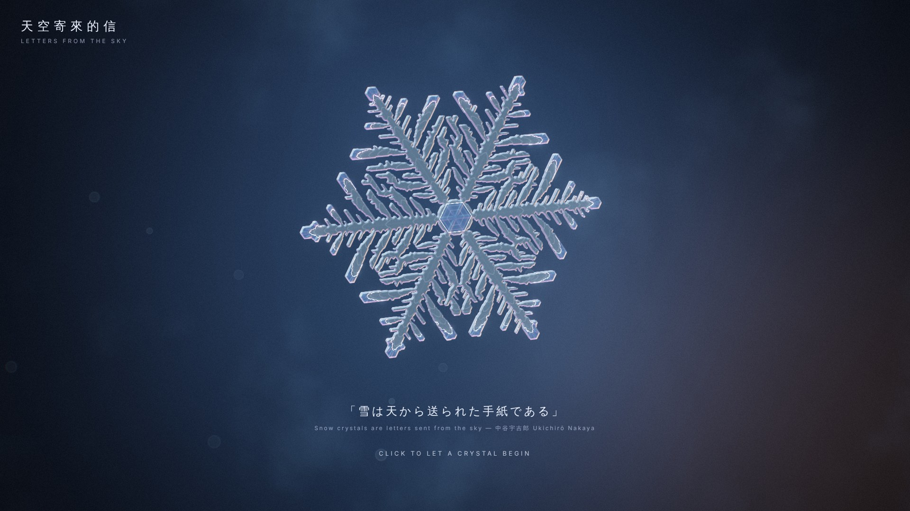
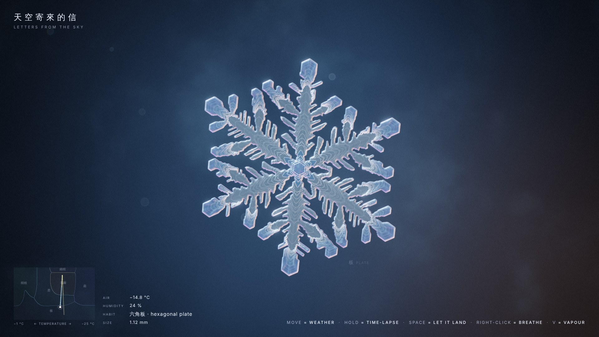
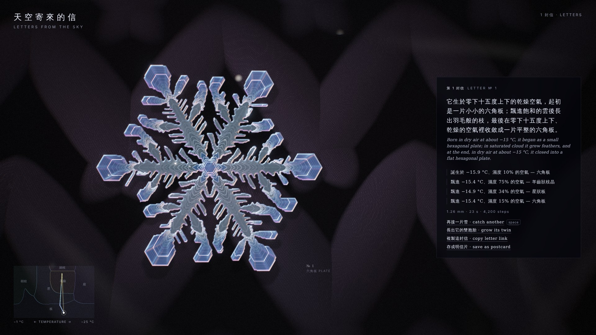
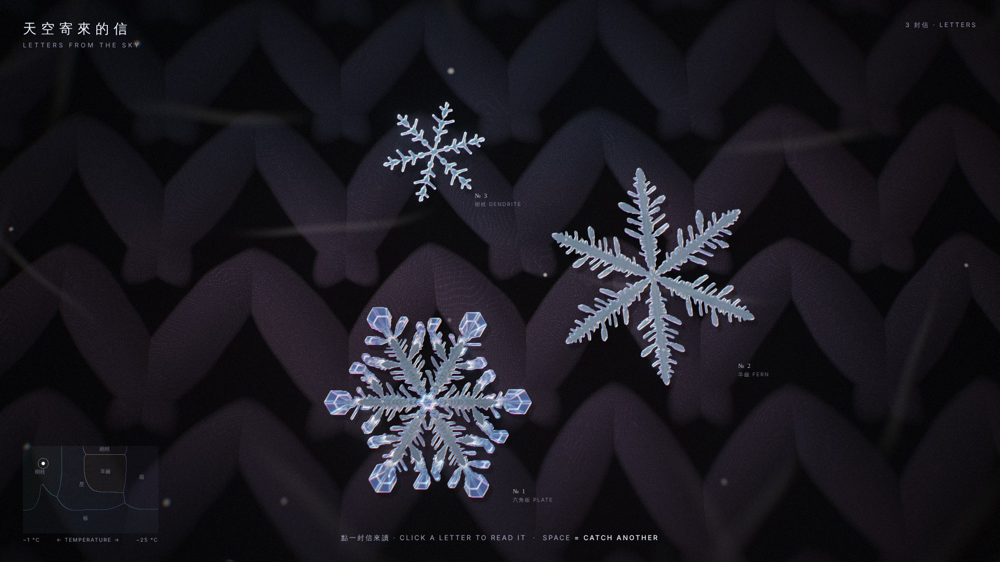
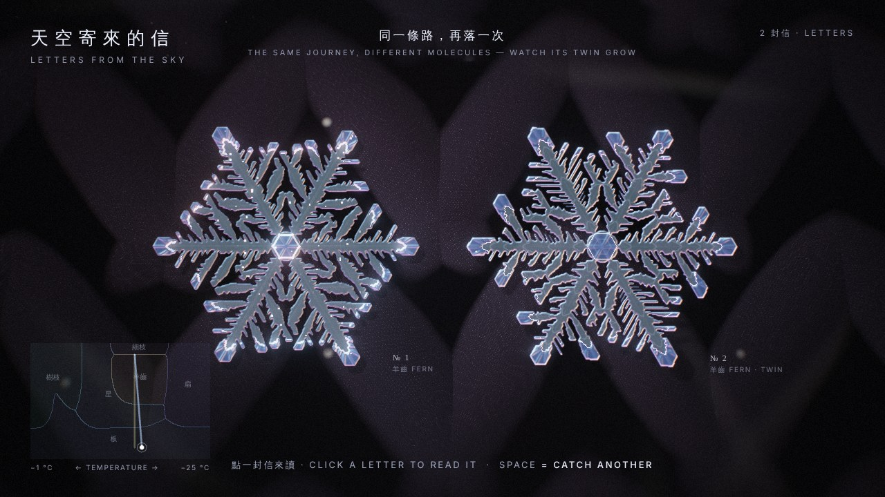

# 天空寄來的信 · Letters from the Sky

> 「雪は天から送られた手紙である」 — 中谷宇吉郎 Ukichirō Nakaya
> *Snow crystals are letters sent from the sky.*

▶ **Live demo:** https://thedreamerstop.github.io/claude-showroom/20261019-letters-from-the-sky/ (desktop Chrome)

A desktop WebGL2 piece in which you *are the weather*. A single ice crystal grows in front of you from a real physical model of
vapour diffusion and attachment (Gravner–Griffeath, *Physica D* 2008), running thousands of lattice steps on the GPU. Your pointer
sets the temperature (left = −1 °C, right = −25 °C) and humidity (up = saturated) of the air the crystal falls through. Different air grows different
habits: plates when it is dry, fern-like dendrites in the humid band around −15 °C, slender stellar dendrites near freezing,
broad sectored plates in deep cold. Because the crystal keeps everything it grew, **its final shape is a record of the path you steered.**
That is Nakaya's "letter", made legible.

Press **Space** and it lands on dark knitted wool (rack focus), flashes, then *re-reads itself*: it regrows in four seconds while its
journey is redrawn on the Nakaya diagram and translated into a short bilingual letter. The camera then pulls back to every letter you have
caught, lying on the wool. **Copy letter link** encodes the journey into the URL, and whoever opens it watches the same crystal grow again.

## Screenshots







Evolution (each sheet comes from the build that an independent review scored, 5 → 6.5 → 7 → 7.5 → 8):
`shots/prototype-sheet.jpg` → `v1-flow.jpg` → `v2-flow-sheet.jpg` → `v3-sheet.jpg` → `v4-sheet.jpg` → `v6-sheet.jpg` → `final-sheet.jpg`.

## Run it

No build step. Serve the repository root with any static server and open this folder, e.g.
`npx http-server -p 8080 -c-1` → `http://localhost:8080/20261019-letters-from-the-sky/`.
URL options: `?mute=1` (no sound), `?stats=1` (frame time, render scale, steps per frame).

## Controls

| Input | Effect |
|---|---|
| click | begin (the opening crystal rewinds into a seed, and yours starts) |
| move the pointer | weather: x = temperature, y = humidity (the mini Nakaya diagram, bottom left, shows where you are and your path) |
| hold the mouse button | time-lapse (4×) |
| **Space** | let it land → letter → gallery; Space again catches another crystal |
| right-click (hold) or **B** | breathe on it: warm air sublimates the thin tips and branches first |
| click a letter in the gallery | revisit it and its text |
| **grow its twin** | replay the letter's *exact* weather with different molecular noise; the twin lands beside the original |
| **copy letter link** | a URL that makes the same journey fall again for whoever opens it |
| **save as postcard** | PNG of the crystal on wool with its letter |
| **V** | show the invisible: the water-vapour field around the crystal, with iso-lines |

## How it works

- **Model** (`js/sim.js`): hexagonal lattice in axial coordinates on a 768² RGBA32F texture. Each step does diffusion (with reflecting crystal
  boundary), then freezing, attachment (1–2 / 3 / ≥4 attached neighbours, with thresholds β, α, θ), melting, and a tiny multiplicative noise.
  Every crystal starts as a small hexagonal prism. Only an active hexagon around the crystal is simulated (scissor box). Its edge is
  held at the ambient vapour density ρ of the current weather, and cells entering it as it grows take that density. The box size
  depends only on the crystal's radius, re-measured on the GPU at least every 128 steps. Growth is therefore deterministic and
  independent of frame rate, which is what makes twins and shared links comparable. Each cell stores the step at which it froze.
- **Weather → parameters** (`js/weather.js`): six anchor parameter sets, chosen by sweeping the model (`tools/explore.html`) and labelled
  by the forms they *actually* grow, blended with sharpened Nakaya-diagram weights.
- **Adaptive pace**: the number of steps per frame follows the measured growth rate, so plates (slow) and dendrites (fast) both grow
  visibly, within a per-frame GPU budget.
- **Birth record**: a timeline texture stores the weather for every 16 steps. Each ice cell looks up the air it froze in. This gives
  growth rings where the weather changed, terraces where the humidity changed, a tint for its birth temperature, and the replay.
- **Rendering** (`js/render.js`): dark-field "macro photograph" shading. The ice body is transparent. The orientation of each edge
  picks which coloured lamp it catches (cool upper-left, warm lower-right, violet below), so edges get colour fringes. The lattice is
  read with *triangle* interpolation, so facets along all three crystal axes stay straight. The crystal is a slab: two plane
  intersections give glowing side walls when it tilts. Micro-facet glints, a fresh-ice glow at the growing front, hexagonal bokeh,
  bloom, ACES, grain and vignette complete the look.
- **Wool**: procedural stockinette, two slanted yarn legs per stitch, with ply twist, fibres, a rim-lit halo of stray hairs, frost
  sparkles that defocus into hexagons, and band-limited depth of field (rack focus).
- **Letters**: each finished crystal is packed into a mip-mapped `TEXTURE_2D_ARRAY` layer and drawn in the gallery pass.
- **Sound**: synthesised wind that follows the weather, and pentatonic chimes as the crystal grows (WebAudio; starts on the first click).

No build step, no dependencies: `index.html` + `js/*.js` (ES modules). It needs desktop Chrome or another browser with WebGL2 and
`EXT_color_buffer_float`.

## Files

```
index.html          page, HUD, letter card
js/gl.js            tiny WebGL2 helpers
js/sim.js           Gravner–Griffeath model on the GPU
js/weather.js       weather → model parameters (Nakaya-diagram anchors)
js/render.js        sky, wool, gallery, crystal, bloom, finish
js/letters.js       journey → words; journey ⇄ URL code
js/main.js          state machine (intro → rewind → grow → land → gallery → rise), input, HUD, audio
tools/explore.html  parameter / journey sweeps used to design the weather map
v1/                 the first end-to-end version, kept for comparison
shots/              screenshots, before/after
docs/               plan, research, reviews, progress log, final report
```
