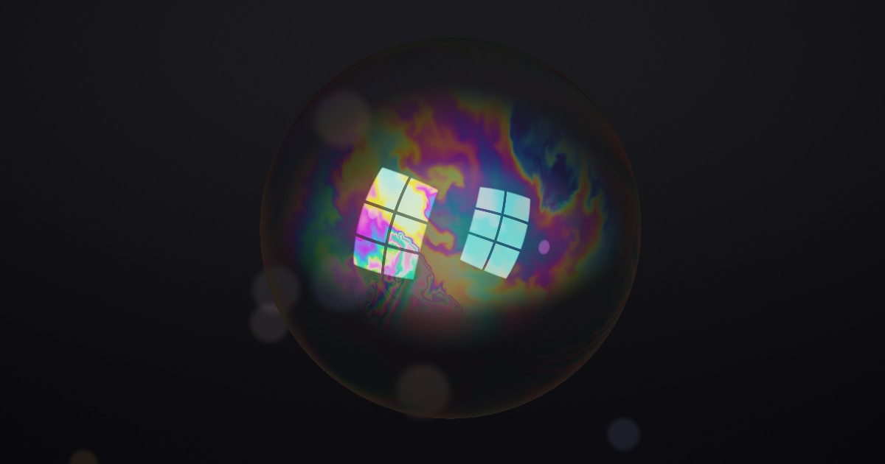

# 一口氣 One Breath

一個肥皂泡。每個顏色都由它的厚度算出來。
*A soap bubble whose every colour is computed from its thickness.*

▶ **Live:** https://thedreamerstop.github.io/claude-showroom/20261112-one-breath/

## 怎麼玩 · How to play

| 動作 Action | 結果 What happens |
|---|---|
| 滑過泡泡 Hover | 顯示游標下那一點、靠近你那面膜的厚度（奈米），右邊色尺同步標出位置。*Shows the thickness of the near wall under the cursor, in nanometres, and marks it on the colour scale. (The second, upside-down window reflection comes from the far wall, so its colour can differ from the number.)* |
| 拖曳 Drag | 用濕手指攪動薄膜。*Stir the film with a wet finger.* |
| 輕點 Tap | 用乾手指戳破它。*Pop it with a dry finger.* |
| 按住 Hold (or Space) | 泡泡破了之後，按住吹氣，放開就停。吹越久泡泡越大，膜越薄，顏色越鮮豔。輕輕一吹會得到一個小泡泡，下半部厚而顏色淡。厚的膜排液也快，所以大小泡泡的壽命差不多。*After a pop, hold to blow and let go to stop. The longer you blow, the bigger the bubble and the thinner its film, so the more vivid its colours. A quick puff makes a smaller bubble with a thick, pale bottom. Thick film also drains faster, so big and small bubbles live about as long.* |
| 手機 Phone | 拖曳時，手指上方會顯示指下的膜厚。*While you drag, the thickness under your finger shows above it.* |

放著不管，泡泡大約 50 秒就會自己破：頂端先變薄，出現黑點，從黑點裂開。
*Left alone, a bubble lives about 50 seconds: the top drains, black spots appear, and it tears open in the black film.*

## 什麼是真的 · What is real

- **顏色 Colour.** 每個像素的顏色都是從膜厚算出來的：光在薄膜的前後兩面反射後互相干涉（單層薄膜的 Airy 公式，水的折射率 1.33，s 與 p 偏振平均），再用 CIE 1931 色彩匹配函數把整條反射光譜積分成 sRGB。沒有手調的調色盤。*Every colour comes from the film's thickness: light reflected off the front and back of the film interferes (Airy formula for one layer, n = 1.33, s and p averaged), and the reflected spectrum is integrated against the CIE 1931 colour-matching functions. No hand-picked palette.*
- **色序 The order of colours.** 所以顏色的順序和真的泡泡一樣：厚的地方近乎無色，越薄越鮮豔，然後是藍、洋紅、琥珀、銀白，最後全黑。*So the colours run in the real order: nearly colourless when thick, vivid as it thins, then blue, magenta, amber, silver, and finally black.*
- **黑膜 Black film.** 薄於約 100 奈米後，膜兩面之間的凡得瓦力會把它拉得更薄、更快。薄於約 20 奈米時兩道反射光幾乎完全抵消，膜看起來是黑的。真的泡泡在破之前就會出現這種黑點。*Below about 100 nm, van der Waals attraction between the two faces pulls the film thinner, faster. Below about 20 nm the two reflections nearly cancel and the film looks black. Real bubbles show these black spots just before they burst.*
- **破裂 The pop.** 破洞的邊緣以 Taylor–Culick 速度 √(2σ / ρh) 前進：1 微米厚的膜約每秒 7 公尺，越薄越快。所以洞不是圓的：它在薄的地方衝得快，在厚的底部慢下來。畫面放慢 200 倍。*The hole's rim runs at the Taylor–Culick speed √(2σ / ρh): about 7 m/s through a 1 µm film, faster where thinner. So the hole is not round: it races through thin film and slows in the thick bottom. Shown 200× slower.*
- **吹大變薄 Stretching.** 吹泡泡時肥皂水的體積不變，表面積變大，所以膜厚與半徑平方成反比。*While blowing, the soap's volume is fixed and its area grows, so thickness falls as 1/R².*
- **兩面 Two walls.** 你同時看到靠近你的那面膜和遠的那面膜（從裡面看）。窗戶因此倒映兩次，一正一反。*You see the near wall and the far wall (from inside), so the window is reflected twice, once each way up.*

## 什麼是簡化的 · What is simplified

- **流動 Flow.** 薄膜的流動是在兩個平面圓盤上算的二維不可壓縮流（前面一半、後面一半，各自是球面的正投影），所以在輪廓邊緣會變形。力有浮力（薄的膜較輕，會往上浮）、重力排液（速率與厚度平方成正比）、蒸發，以及底部的「邊緣再生」薄膜羽流。*The film flow is 2D incompressible flow computed on two flat disks (the front and back halves of the sphere, seen straight on), so it distorts near the silhouette. Forces: buoyancy (thin film rises), gravity drainage (rate ∝ h²), evaporation, and thin-film plumes rising from the bottom (marginal regeneration).*
- **肥皂總量 Soap volume.** 上面那些局部項並不完全守恆。所以每一幀會把整片膜等比例縮放一點，讓平均厚度只依固定的乾燥速度（每秒 1.6 奈米）下降。*Those local terms do not conserve soap exactly. A global correction rescales the film each frame so its mean thickness falls only at a fixed drying rate (1.6 nm/s).*
- **黑膜與破裂 Black film and rupture.** 黑膜在約 12 奈米停住（真的「普通黑膜」也是穩定的一層）。黑點出現後，泡泡會再撐 7 到 13 秒（隨機），然後從最薄的地方破。真的泡泡什麼時候破也是隨機的，但這個區間是挑來好看的。*Black film settles at about 12 nm (real "common black film" is also a stable layer). After black spots appear, the bubble holds for a random 7 to 13 s, then tears at the thinnest spot. Real rupture is random too, but this window is chosen for viewing.*
- **手調的部分 Tuned by eye.** 乾燥集中在泡泡上半部（頂端最快，約為平均的三倍），讓黑膜長在看得見的地方。黑膜從哪裡開始出現，由一張雜訊決定（各處在 25 到 70 奈米之間轉成黑膜），所以它會一塊一塊地長出來。排液速度在膜厚超過約 1.2 微米後就不再加快。看不見的黑膜也會讓破裂的倒數走得慢一點（三成速度）。*Drying is weighted toward the top half (about three times the average at the top), so the black film forms where you can see it. Where film turns black is set by a noise map (each spot snaps between 25 and 70 nm), so it appears in patches. Drainage stops speeding up above about 1.2 µm. Black film out of view also runs down the rupture countdown, at 30% speed.*
- **其他 Other.** 泡泡破後的水滴是示意的：從破口邊緣以邊緣的速度噴出，畫成短短的光痕。壽命是為了好看而選的；真的泡泡從幾秒到幾分鐘都有，看濕度和肥皂。*Droplets after the pop are stylised: they leave the rim at the rim's speed and are drawn as short streaks. The lifetime is chosen for viewing; real bubbles last seconds to minutes depending on humidity and soap.*

## 技術 · Tech

純 WebGL2，沒有函式庫，沒有圖片或音檔：所有畫面和聲音都是即時算出來的。
*Plain WebGL2, no libraries, no image or audio files: every frame and every sound is computed live.*

| 檔案 File | 內容 Contents |
|---|---|
| `js/film.js` | 薄膜光學（干涉、CIE 積分）與 Taylor–Culick 速度。*Thin-film optics and rim speed.* |
| `js/shaders.js` | 模擬（力、平流、壓力投影、排液、破洞前緣）與算圖。*Simulation passes and the renderer.* |
| `js/main.js` | 主迴圈、互動、統計回讀、水滴。*Loop, input, stats readback, droplets.* |
| `js/audio.js` | 合成的室內底噪、吹氣、攪動和破裂聲。*Synthesised room tone, breath, stir and pop.* |
| `js/story.js` | 破掉後的那一句話。*The line shown after a pop.* |
| `tests/` | `npm test`：用 node 驗證物理（色序、黑膜、破裂速度）。*Physics checks in node.* |
| `tools/` | 本機伺服器與無頭瀏覽器截圖。*Local server and headless screenshots.* |

需要支援 WebGL2 與浮點渲染目標的瀏覽器（目前的桌機與手機瀏覽器都可以）。
*Needs WebGL2 with float render targets (current desktop and mobile browsers).*

---
Built with Claude · 由 Claude 協作完成
